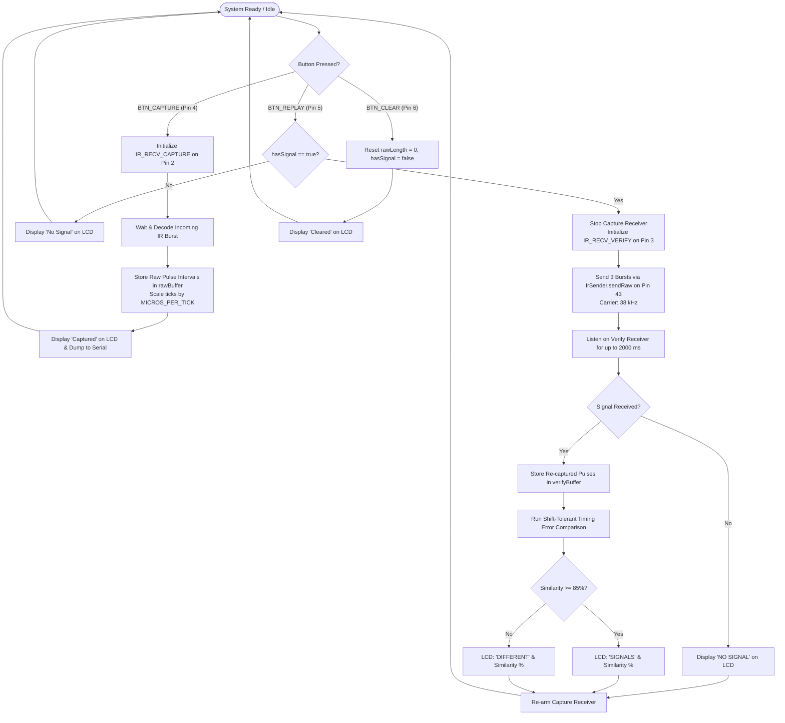

# Universal IR Signal Cloner (ATmega2560)

[-blue.svg)](https://www.arduino.cc/)

A standalone infrared remote-control cloner running on an **ATmega2560** microcontroller that captures arbitrary raw IR pulse streams, replays them through an IR LED, and verifies signal fidelity in real time using a secondary IR receiver and a shift-tolerant timing comparison algorithm.

---

## Demo

> *Placeholder: Add a demo GIF or high-resolution hardware photo into `media/demo.gif` showing the LCD output during capture, replay, and verification.*

---

## Overview

Most consumer IR remote controls operate using proprietary or standard protocols (NEC, Sony, RC5/6, Samsung) modulated at a 38 kHz carrier frequency. Universal learning remotes typically require knowing the decoding protocol.

The **Universal IR Signal Cloner** operates at the **raw pulse-timing layer**, capturing mark/space durations directly into a RAM buffer. To ensure that an emitted replay accurately matches what was originally captured, the board incorporates a **closed-loop dual-receiver architecture**:
1. Receiver 1 captures the unknown remote signal.
2. An IR transmitting LED replays the raw timing bursts at 38 kHz.
3. Receiver 2 listens during transmission to re-acquire the replayed optical signal.
4. An on-chip matching algorithm computes a shift-tolerant timing error and displays the similarity percentage on an HD44780 LCD display.

---

## Features

- **Raw Protocol-Agnostic Capture**: Captures marks and spaces without needing to decode the underlying remote protocol.
- **Closed-Loop Replay Verification**: Dedicated secondary receiver captures the re-emitted optical signal in real time to verify signal integrity.
- **Shift-Tolerant Timing Error Metric**: Compares captured and replayed mark/space timings across a $\pm 3$ index window to accommodate AGC startup jitter.
- **Dynamic Similarity Scoring**: Calculates percentage similarity based on microsecond-level timing deviations against an $85\%$ acceptance threshold.
- **Standalone User Interface**: 16x2 character LCD provides instant feedback (`READY`, `Capturing...`, `Captured`, `SIGNALS XX.X%`, `DIFFERENT XX.X%`, `Cleared`).
- **Physical Pushbutton Controls**: Dedicated tactile inputs for Capture, Replay, and Memory Clear with software debounce.
- **High-Resolution Buffer**: Supports up to 750 raw transition intervals in RAM.

---

## Hardware Required

| Component | Specification / Model | Quantity | Purpose |
|---|---|---|---|
| Microcontroller Board | Arduino Mega 2560 (ATmega2560 @ 16 MHz, 5V) | 1 | Main controller, timers, memory buffer |
| IR Receivers | 38 kHz Demodulating Receiver (e.g. TSOP38238 / CHQ1838) | 2 | Pin 2 (Capture), Pin 3 (Verification) |
| IR Transmitter LED | 940 nm High-Power Infrared Emitter LED | 1 | Optical re-transmission |
| Driver Transistor | NPN Transistor (BC547 / 2N2222) + $1\text{ k}\Omega$ base resistor | 1 | Current driver for IR LED from Pin 43 |
| Current Limiting Resistor | $100\,\Omega - 220\,\Omega$ ($0.25\text{ W}$) | 1 | Protects IR LED during pulse bursts |
| LCD Display | 16x2 Character LCD (HD44780 compatible) | 1 | Status and similarity display |
| Potentiometer | $10\text{ k}\Omega$ Linear Potentiometer | 1 | LCD contrast adjustment (V0) |
| Push Buttons | Momentary Tactile Switches | 3 | Capture, Replay, Clear buttons |
| Pull-Down Resistors | $10\text{ k}\Omega$ resistors | 3 | Required for active-HIGH button inputs |
| Power Supply / Breadboard | 5V DC regulated supply, breadboard, jumper wires | 1 set | Power distribution and interconnects |

---

## Pin Connections & Wiring

> [!IMPORTANT]
> The buttons in this firmware are evaluated as **active-HIGH** (`digitalRead(pin) == HIGH`). Because internal pull-up resistors are not enabled, **external $10\text{ k}\Omega$ pull-down resistors to GND are required** on pins 4, 5, and 6 to prevent floating inputs.

| ATmega2560 Pin | Function in Code | Connected To | Notes / Circuit Details |
|---|---|---|---|
| **Pin 2** | `IR_RECV_CAPTURE` | Primary IR Receiver OUT | Captures external remote control signal |
| **Pin 3** | `IR_RECV_VERIFY` | Secondary IR Receiver OUT | Re-captures replayed optical transmission |
| **Pin 43** | `IR_SEND_PIN` | IR LED Driver Base ($1\text{ k}\Omega$) | Drives BC547 base; collector drives IR LED |
| **Pin 4** | `BTN_CAPTURE` | Capture Pushbutton | Normally LOW via $10\text{ k}\Omega$ pull-down; HIGH when pressed |
| **Pin 5** | `BTN_REPLAY` | Replay Pushbutton | Normally LOW via $10\text{ k}\Omega$ pull-down; HIGH when pressed |
| **Pin 6** | `BTN_CLEAR` | Clear Pushbutton | Normally LOW via $10\text{ k}\Omega$ pull-down; HIGH when pressed |
| **Pin 8** | LCD RS | LCD Pin 4 (RS) | Register Select |
| **Pin 9** | LCD Enable (E) | LCD Pin 6 (E) | Enable Clock Signal |
| **Pin 10** | LCD D4 | LCD Pin 11 (D4) | 4-bit data bus |
| **Pin 11** | LCD D5 | LCD Pin 12 (D5) | 4-bit data bus |
| **Pin 12** | LCD D6 | LCD Pin 13 (D6) | 4-bit data bus |
| **Pin 13** | LCD D7 | LCD Pin 14 (D7) | 4-bit data bus |
| **5V / GND** | VCC / GND | Power Rails | Powers Mega 2560, LCD, receivers, driver |

---

## Architecture & How It Works

### Flowchart

### Verification Algorithm Details

Raw IR signals captured via demodulating sensors (such as the TSOP38238) exhibit edge variations, automatic gain control (AGC) ramp-up timing skews, and sampling tick quantization:

1. **Header Normalization**: The comparison loop starts at index $i = 2$, ignoring initial pre-burst synchronization differences.
2. **Index Shift Tolerance**: To account for missing or delayed leading pulses, the algorithm tests relative shifts:
   $$\text{shift} \in [-3, +3]$$
   For each shift offset, indices $j = i + \text{shift}$ are compared:
   $$\text{diff} = |\text{rawBuffer}[i] - \text{verifyBuffer}[j]|$$
3. **Average Timing Error**: The algorithm computes the sum of absolute timing differences and selects the shift that minimizes the total error:
   $$\text{avgError} = \frac{\min(\text{errorSum})}{\text{count}} \quad [\mu\text{s}]$$
4. **Similarity Percentage Calculation**:
   $$\text{similarity} = \max\left(0, 1.0 - \frac{\text{avgError}}{600.0\,\mu\text{s}}\right)$$
   $$\text{similarityPercent} = \text{similarity} \times 100.0$$
5. **Threshold Decision**: If $\text{similarity} \ge 0.85$ ($85\%$), the LCD confirms a match with `SIGNALS XX.X%`. Otherwise, it flags `DIFFERENT XX.X%`.

---

## Build & Flash Instructions

### Prerequisites
- [Arduino IDE 2.x](https://www.arduino.cc/en/software) or [Arduino CLI](https://arduino.github.io/arduino-cli/)
- USB Type-B cable for Arduino Mega 2560

### Required Libraries
Install the following libraries via the Arduino IDE Library Manager (**Tools > Manage Libraries...**):
1. **IRremote** by *shirriff, z3t0, ArminJo* (version 4.x or later)
2. **LiquidCrystal** (built into the Arduino IDE)

### Flashing Steps
1. Connect the Arduino Mega 2560 to your computer via USB.
2. Open `src/universal_ir_cloner/universal_ir_cloner.ino` in Arduino IDE.
3. In **Tools > Board**, select **Arduino Mega or Mega 2560**.
4. In **Tools > Processor**, select **ATmega2560 (Mega 2560)**.
5. In **Tools > Port**, select the COM port corresponding to your Mega 2560.
6. Click **Upload** (or press `Ctrl+U`).
7. Open **Tools > Serial Monitor** and set the baud rate to **115200 baud** to view real-time debug output and raw pulse timings.

---

## Usage

1. **Power-On**: The LCD displays `IR CLONER / READY` and the serial monitor confirms `System ready`.
2. **Capture**:
   - Point your target IR remote at the **Capture Receiver** (Pin 2).
   - Press the **Capture Button** (Pin 4). The LCD shows `Capturing...`.
   - Press the desired key on your remote. Once captured, the LCD reads `Captured` and the raw microsecond durations are dumped over Serial.
3. **Replay & Verify**:
   - Align the **IR Transmit LED** (Pin 43) towards the **Verify Receiver** (Pin 3).
   - Press the **Replay Button** (Pin 5).
   - The device transmits 3 bursts at 38 kHz, listens on the verify receiver, calculates the similarity score, and displays `SIGNALS 94.2%` (or `DIFFERENT XX.X%`).
4. **Clear Memory**:
   - Press the **Clear Button** (Pin 6) to flush the RAM buffer and re-arm the system.

---

## Challenges & What I Learned

- **Dynamic Receiver Re-initialization**: Calling `IrReceiver.stop()` followed by `IrReceiver.begin(IR_RECV_VERIFY)` allows a single ATmega2560 to switch roles between passive external capture and closed-loop local verification without interrupt collisions.
- **Hardware vs. Software Debounce on Active-HIGH Inputs**: Ensuring consistent detection required checking `digitalRead(pin) == HIGH` after a $40\text{ ms}$ delay, alongside wiring physical $10\text{ k}\Omega$ pull-down resistors to eliminate floating CMOS pin states.
- **Shift-Tolerant Timing Metric**: Standard hash-based IR decoding fails on unrecognized or proprietary protocols. Implementing microsecond-level raw pulse array comparison with bounded shift offsets ($\pm 3$ index leeway) enables verification across arbitrary protocols despite receiver AGC latency.

---

## Future Improvements

- [ ] **EEPROM Non-Volatile Storage**: Persist captured signal arrays to ATmega2560 internal EEPROM (4 KB) so learned commands survive power loss (currently stored in volatile SRAM).
- [ ] **Configurable Carrier Frequency**: Support non-standard carrier frequencies (e.g. 36 kHz, 40 kHz, 56 kHz) by dynamically reconfiguring hardware timer registers (currently fixed at 38 kHz in `IrSender.sendRaw`).
- [ ] **Direct Register-Level Timer2 PWM Generation**: Implement direct register-level CTC/Fast-PWM timer manipulation to bypass library carrier generation overhead.
- [ ] **Multi-Slot Profile Management**: Add an interactive menu on the LCD to store and recall multiple remote button profiles.

---

## License & Contact

Distributed under the **MIT License**. See [LICENSE](LICENSE) for details.

- **Author**: Rudra Patel
- **Institution**: Pandit Deendayal Energy University (PDEU), B.Tech ICT
- **Target Role**: Embedded Software / Firmware Engineer
- **LinkedIn**: [linkedin.com/in/rudra-patel0314](https://www.linkedin.com/in/rudra-patel0314/)
- **Email**: [rudrapatel0314@gmail.com](mailto:rudrapatel0314@gmail.com)
